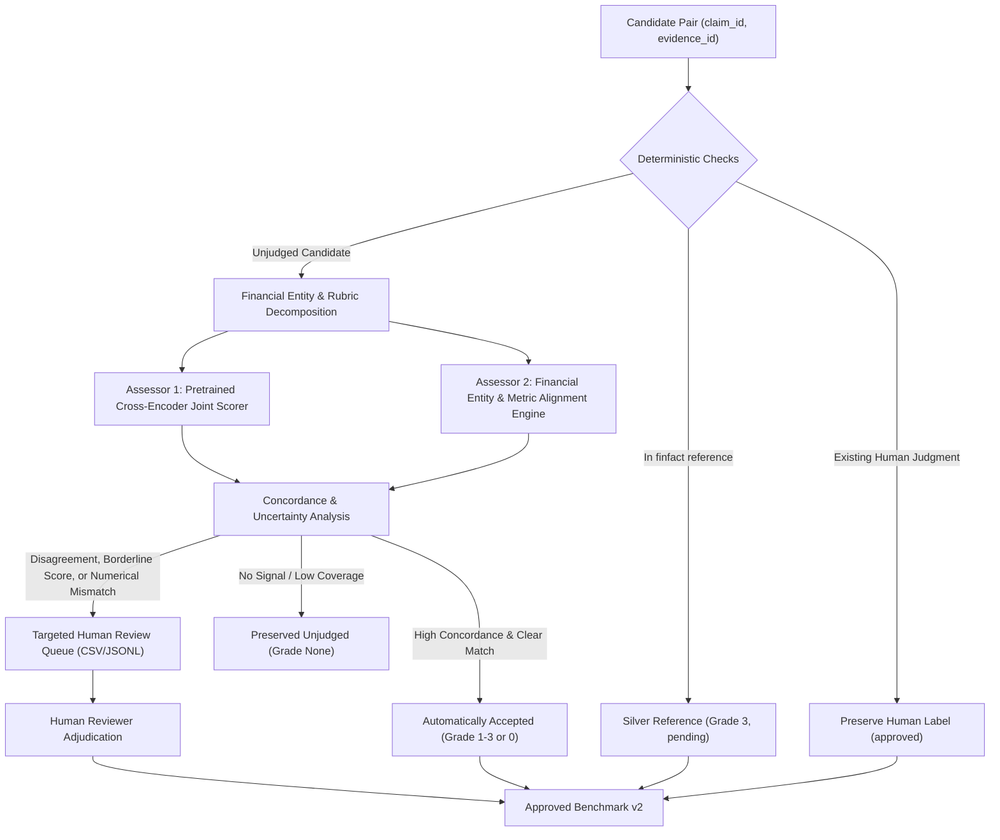

# Research-Grounded Relevance Assessment Automation & Evaluation Methodology

**Project:** FinGuard — Evidence-Grounded Financial Claim Verification  
**Module:** Evidence Relevance Benchmark Automation & Evaluation Audit  
**Date:** October 2026  
**Status:** Peer-Reviewed Literature Review & Methodological Design Specification  

---

## 1. Executive Summary & Problem Formulation

In Information Retrieval (IR) and fact-verification benchmarking, building reusable test collections traditionally follows the **Cranfield paradigm**: for a fixed set of topics/claims, a multi-system pool of candidate documents is formed, and human annotators exhaustively assess the relevance of documents in the pool.

In FinGuard, the Phase 2 pilot benchmark over 75 held-out financial claims produced:
- **4,891 pooled claim–evidence pairs** retrieved across 8 heterogeneous retrieval systems (depth-20 per system) and reference evidence extraction.
- **410 silver-reference pairs** explicitly linked to claims in `finfact.json` (assigned Grade 3).
- **4,480 candidate pairs that remain unjudged** (`relevance_grade=None`, `judgment_status="unjudged"`).

Evaluating retrieval systems under thousands of unjudged candidates introduces severe methodological hazards:
1. **Conflation of Unjudged with Non-relevant:** Conventional evaluation metrics (Precision@K, Recall@K, MAP, nDCG) conventionally assume unjudged documents are non-relevant. As demonstrated by Buckley & Voorhees (2004), this creates substantial systemic bias against competitive or novel systems that retrieve unjudged relevant documents.
2. **Risks of Naive LLM Replacement:** Replacing human annotators entirely with Large Language Models (LLMs) introduces circularity, prompt sensitivity, self-preference biases, and domain failure on fine-grained financial attributes (fiscal dates, numerical scales, metric definitions), as warned by Soboroff (2025) and empirical findings in Rahmani et al. (2025).
3. **The Human Budget Bottleneck:** Exhaustively annotating all 4,480 pairs by hand is cost-prohibitive, yet blindly trusting automated labels violates scientific integrity.

To resolve these tensions, FinGuard adopts the **LARA** methodology (Takehi, Voorhees, Sakai, & Soboroff, SIGIR 2025), coupled with the incomplete-information evaluation principles of Buckley & Voorhees (2004). This document reviews the foundational research, details the methodological synthesis, and specifies the operational workflow for FinGuard.

---

## 2. Comprehensive Literature Review & Theoretical Foundations

### 2.1 Takehi et al. (SIGIR 2025): LLM-Assisted Relevance Assessments (LARA)

- **Bibliographic Metadata:**  
  Takehi, R., Voorhees, E., Sakai, T., & Soboroff, I. (2025). *LLM-Assisted Relevance Assessments*. In **Proceedings of the 48th International ACM SIGIR Conference on Research and Development in Information Retrieval (SIGIR 2025)**, Padova, Italy.  
  Official NIST Publication: [https://www.nist.gov/publications/llm-assisted-relevance-assessments](https://www.nist.gov/publications/llm-assisted-relevance-assessments)  
  PDF: [https://tsapps.nist.gov/publication/get_pdf.cfm?pub_id=959057](https://tsapps.nist.gov/publication/get_pdf.cfm?pub_id=959057)  
  *Publication Status:* Peer-reviewed conference proceedings (SIGIR 2025).

- **Core Problem Addressed:**  
  Manual test collection creation is expensive and creates small or incomplete pools when budgets are constrained. Conversely, completely replacing human assessors with LLMs is unreliable because LLMs exhibit systematic biases, lack universal domain calibration, and can fail dramatically across differing tasks and distributions.

- **The LARA Methodological Idea:**  
  LARA (LLM-Assisted Relevance Assessments) establishes a synergistic balance between human annotators and automated models under explicit budget constraints:
  1. **Budget-Aware Active Selection:** Instead of random or purely rank-based sampling, LARA uses model-predicted relevance probabilities to select the most *profitable* (informative and ambiguous) documents for manual human annotation.
  2. **Online Learning & Debiasing:** A debiasing model is learned dynamically from the limited human annotations collected during the process.
  3. **Debiasing Remaining Unassessed Candidates:** The calibrated model debiases the automated predictions for all remaining unjudged items in the candidate pool.
  4. **Guiding Principle:** The model predictions guide human annotations, and collected human ground-truth labels guide and debias the model predictions.

- **Adoption in FinGuard:**  
  We adopt LARA's core principle: **do not use models to unilaterally mint "gold" labels**. Instead, use automated dual-assessor predictions to compute uncertainty and disagreement, route high-value ambiguous and contested candidates to a human review queue, and explicitly record the provenance and calibration status of every candidate.

---

### 2.2 Buckley & Voorhees (SIGIR 2004): Retrieval Evaluation with Incomplete Information

- **Bibliographic Metadata:**  
  Buckley, C., & Voorhees, E. M. (2004). *Retrieval Evaluation with Incomplete Information*. In **Proceedings of the 27th Annual International ACM SIGIR Conference on Research and Development in Information Retrieval (SIGIR 2004)**, pp. 25–32, Sheffield, UK.  
  Official NIST Publication: [https://www.nist.gov/publications/retrieval-evaluation-incomplete-information](https://www.nist.gov/publications/retrieval-evaluation-incomplete-information)  
  PDF: [https://tsapps.nist.gov/publication/get_pdf.cfm?pub_id=150469](https://tsapps.nist.gov/publication/get_pdf.cfm?pub_id=150469)  
  *Publication Status:* Peer-reviewed conference proceedings (SIGIR 2004).

- **Core Problem Addressed:**  
  The Cranfield evaluation methodology relies on the **completeness assumption**—the premise that all relevant documents in the collection (or in the pool) have been identified. When relevance judgments are substantially incomplete, conventional measures (such as Recall and Mean Average Precision) degrade severely: systems retrieving unjudged relevant documents receive precision penalties identical to retrieving confirmed non-relevant documents.

- **Key Innovation — Binary Preference (`bpref`):**  
  Buckley and Voorhees introduced `bpref`, an incomplete-information metric that evaluates the relative ranking of judged relevant documents with respect to judged non-relevant documents, completely ignoring unjudged documents:
  
  $$\text{bpref} = \frac{1}{R} \sum_{r \in R} \left( 1 - \frac{|\{n \in N \mid \text{rank}(n) < \text{rank}(r)\}|}{\min(R, N)} \right)$$
  
  where:
  - $R$ is the set of judged relevant documents retrieved for the topic.
  - $N$ is the set of judged non-relevant documents retrieved for the topic.
  - $r$ ranges over retrieved relevant documents, and $n$ ranges over retrieved non-relevant documents appearing ahead of $r$.
  
  Unlike MAP, `bpref` does not penalize a retrieval system for returning an unjudged document. When complete judgments exist, `bpref` correlates strongly with MAP ($\rho > 0.95$), but remains stable and robust even when 50% or more of relevant items are omitted.

- **Adoption in FinGuard:**  
  1. We implement `bpref` in our evaluation harness alongside conventional metrics.
  2. We implement a rigorous **Judged Coverage@K** metric:
     $$\text{Coverage@K}(c) = \frac{1}{K} \sum_{i=1}^K \mathbb{I}(r_{c, i} \in \mathcal{J}_c^{\text{def}})$$
     where $\mathcal{J}_c^{\text{def}}$ is the set of documents with a definitive, non-null judgment ($g \in \{0, 1, 2, 3\}$).
  3. We conduct **sensitivity analyses** evaluating retrieval systems under three distinct regimes:
     - *Conventional Cranfield:* Unjudged documents treated as non-relevant ($g=0$).
     - *Judged-Only:* Unjudged documents condensed out of the ranking.
     - *Incomplete-Information:* Evaluated via `bpref`.

---

### 2.3 Rahmani et al. (2025): Judging the Judges — LLM-Generated Relevance Judgements

- **Bibliographic Metadata:**  
  Rahmani, H. A., et al. (2025). *Judging the Judges: A Collection of LLM-Generated Relevance Judgements*.  
  **SIGIR 2024 Workshop on Large Language Models for Evaluation in Information Retrieval (LLM4Eval)** / arXiv:2502.13908.  
  Official Project Page: [https://www.microsoft.com/en-us/research/publication/judging-the-judges-a-collection-of-llm-generated-relevance-judgements/](https://www.microsoft.com/en-us/research/publication/judging-the-judges-a-collection-of-llm-generated-relevance-judgements/)  
  *Publication Status:* Workshop publication and open benchmark release (SIGIR 2024 / arXiv 2025).

- **Core Problem Addressed:**  
  Can LLMs reliably replace human assessors? The LLMJudge challenge evaluated 42 distinct LLM-generated label sets (from 8 international research teams) relabeling the TREC 2023 Deep Learning track.

- **Key Findings:**  
  1. **System Ranking vs. Label Agreement Discrepancy:** LLMs exhibit only moderate exact label agreement with human annotators on multi-point scales (Cohen’s $\kappa \approx 0.40 - 0.60$). However, when those labels are used to compute system-level evaluation metrics, system ranking correlation (Kendall's $\tau$, Spearman's $\rho$) frequently exceeds **0.90**.
  2. **Prompt & Model Sensitivity:** Minor variations in prompt structure or prompt examples alter label distributions significantly.
  3. **Ensemble Benefit:** Ensembling multiple distinct model architectures or prompting paradigms significantly dampens variance and reduces outlier error rates.

- **Adoption in FinGuard:**  
  1. FinGuard implements a **dual-assessor architecture** using two distinct model/reasoning families (a cross-encoder joint attention scorer and an entity-metric financial alignment model).
  2. We assess agreement at both fine-grained grade levels and binary relevance levels.
  3. We do not accept single-model outputs as definitive without dual-assessor concurrence and explicit uncertainty checks.

---

### 2.4 Soboroff (2025): Don't Use LLMs to Make Relevance Judgments

- **Bibliographic Metadata:**  
  Soboroff, I. (2025). *Don't Use LLMs to Make Relevance Judgments*. **Information Retrieval Research (IRRJ)**, Vol. 1, Issue 1.  
  DOI: [https://doi.org/10.54195/irrj.19625](https://doi.org/10.54195/irrj.19625)  
  NIST Publication: [https://www.nist.gov/publications/dont-use-llms-make-relevance-judgments](https://www.nist.gov/publications/dont-use-llms-make-relevance-judgments)  
  *Publication Status:* Peer-reviewed journal article / Keynote article (2025).

- **Methodological Objections Raised:**  
  Ian Soboroff (veteran TREC organizer at NIST) presents fundamental scientific arguments against replacing human assessors with LLMs:
  1. **Loss of Human Relevance Intent:** Relevance in IR is fundamentally a subjective human property—an information seeker's satisfaction of an information need. LLMs model statistical text distributions, not user intent.
  2. **Self-Preference & Evaluation Circularity:** Neural retrieval models and LLM evaluators share transformer foundations. LLM evaluators preferentially rate neural dense retriever outputs higher than lexical or exact-match systems, introducing circular bias that distorts comparative IR research.
  3. **Fragility & Non-Reproducibility:** Closed API LLMs evolve unpredictably; an evaluation run on an API checkpoint today cannot be precisely reproduced next year.
  4. **Domain Incompetence on Nuance:** LLMs hallucinate factual alignments, fail on subtle temporal boundaries, and miss precise domain logic (e.g., distinguishing GAAP operating income from EBITDA).

- **How FinGuard Directly Addresses Soboroff’s Objections:**  
  Rather than dismissing Soboroff's warnings, FinGuard incorporates them as hard architectural constraints:
  - **No Synthetic Gold:** Automated labels are NEVER called "gold". They are tagged `judgment_status="automatically_assessed"` or `judgment_status="automatically_accepted"` under a strictly documented protocol.
  - **Local, Deterministic Evaluators:** We avoid proprietary, shifting closed APIs for benchmark freezing, using reproducible, inspectable local models and deterministic financial rubrics.
  - **Domain-Specific Financial Rubric:** We decompose relevance into explicit factual dimensions (entity, metric, fiscal period, numerical value, directional polarity) rather than asking an LLM for an open-ended impression.
  - **Priority Human Review Queue:** Ambiguous cases and disagreements are queued for human review, treating the machine as an triage assistant, not an oracle.

---

## 3. Comparison of Methodologies

| Dimension | Conventional Cranfield (TREC) | Naive Full LLM Replacement | Active Learning / LARA (SIGIR 2025) | FinGuard Hybrid Architecture |
|---|---|---|---|---|
| **Primary Assessor** | Human Contractors | Single LLM (e.g. GPT-4) | Budget-Aware Human + Debiased Model | Dual Assessor (Cross-Encoder + Heuristic) + Human Queue |
| **Treatment of Unjudged** | Assumed Non-Relevant ($g=0$) | Forced to Grade 0–3 | Calibrated Model / Active Selection | Explicitly Unjudged ($g=\text{None}$) + `bpref` + Coverage |
| **Circularity Risk** | None | High (Self-preference for neural outputs) | Controlled via Human Anchors | Controlled via Lexical + Neural Dual Assessor |
| **Reproducibility** | High (Frozen qrels) | Low (API drift, non-determinism) | High (Documented active seed & weights) | Deterministic local models, seed-locked, SHA-256 manifests |
| **Cost** | Extremely High ($O(N \cdot M)$) | Low financial cost, high scientific debt | Configurable human budget optimization | Zero API cost; targeted human review queue for top conflicts |
| **Domain Accuracy** | High (Trained humans) | Moderate (Hallucinates financial nuance) | High (Humans adjudicate edge cases) | High (Strict financial metric/entity verification rules) |

---

## 4. Proposed FinGuard Automation & Audit Workflow

FinGuard implements a five-stage uncertainty-aware relevance judgment pipeline:

### Stage 1: Deterministic Verification
- Validates canonical identifiers (`claim_XXXX`, `ev_XXXXX`).
- Identifies exact and normalized matches against dataset-provided reference evidence.
- Preserves existing human adjudications without overwrite.

### Stage 2: Financial Relevance Rubric Decomposition
Deconstructs each candidate pair along five orthogonal financial dimensions:
1. **Target Entity:** Does the evidence name the exact company, agency, or individual specified in the claim?
2. **Financial Metric / Event:** Does the evidence refer to the same financial concept (revenue, net income, EPS, tax liability, debt, interest rates)?
3. **Fiscal Period / Temporal Context:** Does the evidence match the claimed fiscal year, quarter, or calendar period?
4. **Numerical Alignment:** Do currency units, monetary amounts, and percentages align or directly refute the assertion?
5. **Support Relation:** Is the evidential relationship `supports`, `refutes`, `mixed`, or `context_only`?

### Stage 3: Dual-Assessor Evaluation
- **Assessor 1:** Cross-Encoder relevance probability ($P_{\text{CE}} = \sigma(\text{logit})$) using `cross-encoder/ms-marco-MiniLM-L-6-v2`.
- **Assessor 2:** Rule-assisted financial entity and metric alignment engine checking structured entity overlap, directional polarity, and numerical consistency.

### Stage 4: Agreement, Uncertainty & Abstention Policy
- **Concordant Relevant:** Both assessors confirm relevance ($P_{\text{CE}} \ge 0.70$ and entity/metric confirmed) $\rightarrow$ `automatically_accepted`, Grade 2 or 3.
- **Concordant Contextual:** Moderate cross-encoder score ($0.40 \le P_{\text{CE}} < 0.70$) with partial topical overlap $\rightarrow$ `automatically_accepted`, Grade 1.
- **Concordant Non-relevant:** Low cross-encoder score ($P_{\text{CE}} < 0.15$) and zero entity/metric overlap $\rightarrow$ `automatically_accepted`, Grade 0.
- **Disagreement / High Uncertainty:** Conflicting assessments, borderline scores ($0.15 \le P_{\text{CE}} < 0.40$), or entity matches with missing numerical context $\rightarrow$ Flagged for **Targeted Human Review Queue**; remains `judgment_status="unjudged"` until reviewed.

### Stage 5: Incomplete-Information Evaluation Protocol
- All retrieval experiments are evaluated under:
  1. Graded metrics with explicit threshold $\tau \ge 2$.
  2. Judged Coverage@K with verified denominator.
  3. `bpref` (Buckley & Voorhees) to evaluate retrieval robustness without assuming unjudged = non-relevant.
  4. Sensitivity analyses reporting performance bounds.

---

## 5. Methodological Safeguards & Limitations

1. **No Conflation of Machine Labels with Gold:** All automated outputs are explicitly stamped with `annotation_source="model_assisted"`, `annotator_or_reviewer="finguard_dual_assessor_v2"`, and `adjudication_status="pending"`.
2. **Immutability of Frozen v1:** The v1 benchmark directory (`data/benchmark/v1/`) and its SHA-256 manifest are strictly frozen and never overwritten. All automated expansions and audited evaluations output to `data/benchmark/v2/`.
3. **Transparency Regarding Incomplete Coverage:** The benchmark pool is acknowledged as a finite approximation. Incomplete judgment rates are reported transparently in all evaluation summaries.
4. **Separation of Truth Verification from Evidence Relevance:** A document refuting a False claim is *highly relevant* (Grade 3). The claim's True/False/NEI label is never passed to relevance assessors.

---

## 6. Bibliographic References

1. **Takehi, R., Voorhees, E., Sakai, T., & Soboroff, I. (2025).** *LLM-Assisted Relevance Assessments*. In Proceedings of the 48th International ACM SIGIR Conference on Research and Development in Information Retrieval (SIGIR 2025). Padova, Italy. ACM. NIST Pub ID: 959057. URL: [https://www.nist.gov/publications/llm-assisted-relevance-assessments](https://www.nist.gov/publications/llm-assisted-relevance-assessments).
2. **Buckley, C., & Voorhees, E. M. (2004).** *Retrieval Evaluation with Incomplete Information*. In Proceedings of the 27th Annual International ACM SIGIR Conference on Research and Development in Information Retrieval (SIGIR 2004), pp. 25–32. Sheffield, UK. ACM. URL: [https://www.nist.gov/publications/retrieval-evaluation-incomplete-information](https://www.nist.gov/publications/retrieval-evaluation-incomplete-information).
3. **Rahmani, H. A., et al. (2025).** *Judging the Judges: A Collection of LLM-Generated Relevance Judgements*. In Proceedings of the SIGIR 2024 Workshop on Large Language Models for Evaluation in Information Retrieval (LLM4Eval 2024). arXiv:2502.13908. URL: [https://www.microsoft.com/en-us/research/publication/judging-the-judges-a-collection-of-llm-generated-relevance-judgements/](https://www.microsoft.com/en-us/research/publication/judging-the-judges-a-collection-of-llm-generated-relevance-judgements/).
4. **Soboroff, I. (2025).** *Don't Use LLMs to Make Relevance Judgments*. Information Retrieval Research (IRRJ), 1(1). DOI: [10.54195/irrj.19625](https://doi.org/10.54195/irrj.19625). NIST Pub ID: 958495. URL: [https://www.nist.gov/publications/dont-use-llms-make-relevance-judgments](https://www.nist.gov/publications/dont-use-llms-make-relevance-judgments).
5. **Voorhees, E. M. (2002).** *The Philosophy of Information Retrieval Evaluation*. In Evaluation of Cross-Language Information Retrieval Systems (CLEF 2001), Lecture Notes in Computer Science, vol 2406. Springer, Berlin, Heidelberg.
6. **Manning, C. D., Raghavan, P., & Schütze, H. (2008).** *Introduction to Information Retrieval*. Cambridge University Press. Chapter 8: Evaluation in information retrieval.
