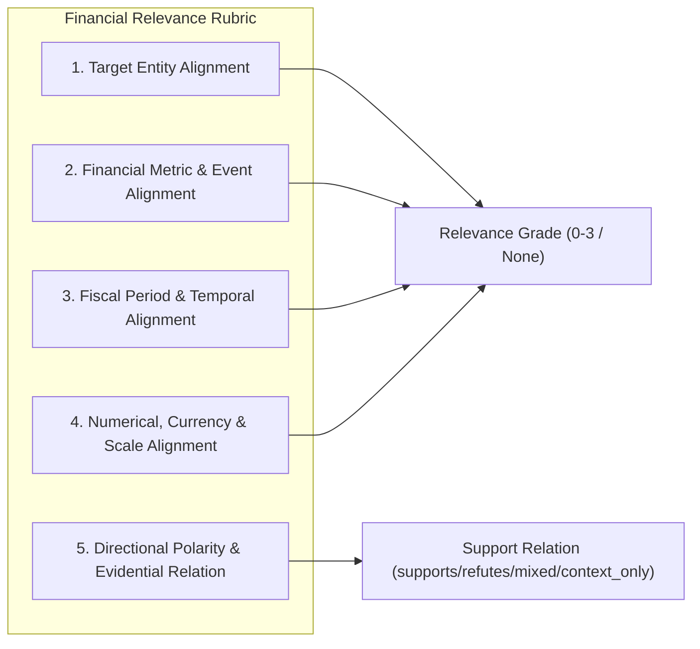

# FinGuard Relevance Judgment Protocol & Financial Annotation Rubric

**Version:** 2.0.0  
**Effective Date:** October 2026  
**Module:** `src/judgment_automation.py`  
**Target Repository:** FinGuard — Evidence-Grounded Financial Claim Verification  

---

## 1. Overview & Architectural Principles

This protocol defines the formal rules, criteria, and operational workflows for assessing the relevance of candidate evidence passages retrieved for financial claims.

### Core Safeguards:
1. **Relevance is Distinct from Claim Veracity:**  
   Relevance measures whether an evidence passage directly informs, supports, refutes, or contextualizes the factual assertion made in the claim. A passage that definitively refutes a False claim is **Grade 3 (Directly Decisive)**, NOT Grade 0. The claim's verdict (`true`, `false`, `NEI`) must NEVER be used to infer passage relevance.
2. **Silver-Reference Evidence is Non-Exhaustive:**  
   Sentences extracted from `finfact.json` are treated as *silver reference evidence* (`judgment_status="silver_reference"`). Their presence confirms relevance, but their absence does NOT imply non-relevance for other retrieved passages.
3. **No Synthetic Gold:**  
   Machine-generated or heuristic assessments are strictly tagged as `annotation_source="model_assisted"`. Under no circumstances may an automated label be designated as human gold.
4. **Preservation of Uncertainty:**  
   Uncertain, ambiguous, or unreviewed candidate pairs are explicitly preserved as `relevance_grade=None` (`judgment_status="unjudged"`). Missing annotations are never silently imputed as Grade 0.

---

## 2. Formal Five-Grade Relevance Scale

FinGuard uses an ordinal four-tier scale (Grades 0 to 3) plus an explicit `Unjudged` representation:

| Grade | Label | Formal Definition | Decision Criteria |
|---|---|---|---|
| **3** | **Directly Decisive Evidence** | Strongly supports or refutes the core factual assertion, matching the target entity, financial metric, time period, and numerical context. | The evidence sentence provides sufficient factual grounds to verify or debunk the claim independently or with basic domain knowledge. |
| **2** | **Substantially Relevant Evidence** | Provides meaningful factual support or contradiction but is incomplete or requires contextual interpretation. | The evidence addresses the specific entity and financial metric/event, but lacks one detail (e.g., exact fiscal quarter, complete numerical total, or background baseline). |
| **1** | **Contextually Relevant Evidence** | Provides helpful economic, institutional, or industry background, but does not independently establish truth or falsity. | The evidence mentions the entity or general topic (e.g. macro interest rate policy, general corporate operations) without resolving the specific claim assertion. |
| **0** | **Judged Not Relevant** | Confirmed by review or high-confidence filter to contain no material connection to the claim's factual assertion. | The text refers to an unrelated company, unrelated industry, or coincidentally shares a common keyword (e.g. "shares", "growth") without topical connection. |
| **None** | **Unjudged (Unknown)** | No defensible, verified judgment exists. | Candidate was retrieved during pooling but has not undergone definitive human review or validated high-confidence dual-assessor acceptance. |

---

## 3. Financial Relevance Rubric Dimensions

To avoid vague subjective impressions, relevance assessment decomposes each claim–evidence pair across five orthogonal dimensions:

### Dimension 1: Target Entity Alignment
- **Strict Match:** Evidence explicitly names the primary company, organization, government body, or executive (e.g., `Amazon`, `Federal Reserve`, `Tesla`, `Elon Musk`).
- **Subsidiary / Alias Match:** Evidence names an official subsidiary, ticker symbol, or accepted alias (e.g., `AWS` for Amazon, `Alphabet` for Google, `FOMC` for Federal Reserve).
- **Mismatch:** Evidence names a completely different entity operating in the same sector (e.g., `Microsoft` when the claim is about `Amazon`). If entity is mismatched, the passage is almost always **Grade 0**.

### Dimension 2: Financial Metric & Event Alignment
- **Target Financial Metric:** The evidence must address the specific financial concept in the claim:
  - *Income Statement:* Revenue, gross margin, operating expenses, net income, EBITDA, earnings per share (EPS).
  - *Balance Sheet & Cash Flow:* Total debt, cash reserves, free cash flow, assets, liabilities.
  - *Tax & Regulatory:* Federal corporate income tax, effective tax rate, SEC fines, antitrust settlement.
  - *Market & Macro:* Share price, market capitalization, CPI inflation rate, federal funds rate, unemployment rate.
- **Metric Confusion Warning:** Conflating distinct financial metrics (e.g. treating *revenue* as *net profit*, or *statutory tax rate* as *cash taxes paid*) reduces grade to Grade 1 or 0.

### Dimension 3: Fiscal Period & Temporal Alignment
- **Exact Fiscal Period:** Matches the claimed year, quarter, or exact timestamp (e.g., `FY2018`, `Q3 2021`, `July 2020`).
- **Adjacent Period / Trend Context:** Covers an adjoining period providing trend context (Grade 1 or 2).
- **Historical Mismatch:** Cites data from a completely different decade or economic era without continuity $\rightarrow$ Grade 0.

### Dimension 4: Numerical, Currency, and Scale Alignment
- **Scale Integrity:** Distinguishes millions (`$M`), billions (`$B`), and trillions (`$T`). A passage reporting `$15 million` does not substantiate a claim of `$15 billion`.
- **Currency Alignment:** Distinguishes USD (`$`), EUR (`€`), GBP (`£`), INR (`₹`), etc.
- **Percentage vs. Basis Points:** Distinguishes a `2% increase` from a `2 percentage point / 200 bps increase`.

### Dimension 5: Evidential Support Relation
Categorized independently from relevance grade:
- `supports`: Directly corroborates the claim's assertion.
- `refutes`: Directly contradicts, disproves, or debunks the claim's assertion.
- `mixed`: Contains elements of both corroboration and contradiction.
- `context_only`: Provides topical background without taking an evidential stance.
- `unknown`: Relation cannot be determined from the passage alone.

---

## 4. Multi-Stage Automated Assessment Pipeline

FinGuard’s automated assessment engine (`src/judgment_automation.py`) processes unjudged candidates through three stages:

### Stage 1: Deterministic Filtering & Reference Linking
- Validates canonical IDs and hashes.
- Detects whether candidate matches dataset-provided reference evidence (assigned `silver_reference`, Grade 3).
- Preserves human-adjudicated pairs without modification.

### Stage 2: Dual-Assessor Scoring
To avoid single-model bias, two independent evaluation methods are combined:

1. **Assessor 1 (Cross-Encoder Joint Attention Scorer):**  
   Uses `cross-encoder/ms-marco-MiniLM-L-6-v2` to compute an unconstrained continuous relevance score:
   $$P_{\text{CE}} = \sigma(\text{logit}(\text{claim}, \text{evidence})) \in [0.0, 1.0]$$
   Evaluates full bi-directional cross-attention between claim and evidence tokens.

2. **Assessor 2 (Financial Rubric & Entity-Metric Scorer):**  
   Executes deterministic entity-metric alignment:
   - Extracts named financial entities, monetary values, percentages, fiscal dates, and directional verbs via `FinancialQueryBuilder` and regex extractors.
   - Computes normalized token overlap, entity inclusion, and numerical concordance.
   - Assigns a heuristic rule-based grade $G_{\text{rule}} \in \{0, 1, 2, 3\}$.

### Stage 3: Concordance, Disagreement & Acceptance Rules

The pair is classified according to explicit concordance boundaries:

| Condition | Assigned Grade | Status | Queue Route |
|---|---|---|---|
| $P_{\text{CE}} \ge 0.70$ AND $G_{\text{rule}} \ge 2$ | 3 (if numerical match) or 2 | `automatically_accepted` | Automated Bank (Validated) |
| $0.40 \le P_{\text{CE}} < 0.70$ AND $G_{\text{rule}} \ge 1$ | 1 | `automatically_accepted` | Automated Bank (Contextual) |
| $P_{\text{CE}} < 0.15$ AND $G_{\text{rule}} == 0$ | 0 | `automatically_accepted` | Automated Bank (Non-relevant) |
| **Disagreement:** $P_{\text{CE}} \ge 0.60$ but $G_{\text{rule}} == 0$ | None | `unjudged` | **High-Priority Human Review Queue** |
| **Disagreement:** $P_{\text{CE}} < 0.25$ but $G_{\text{rule}} \ge 2$ | None | `unjudged` | **High-Priority Human Review Queue** |
| **Borderline:** $0.20 \le P_{\text{CE}} < 0.40$ | None | `unjudged` | **Standard Human Review Queue** |
| **Low Signal / Incomplete:** | None | `unjudged` | Retained as Unjudged |

---

## 5. Cost-Aware Human Review Queue & Prioritization

To maximize the impact of limited human annotation effort under the LARA paradigm, candidates in the review queue are prioritized by an **Information Gain Score**:

$$\text{Priority}(c, e) = w_1 \cdot \text{Disagreement}(c, e) + w_2 \cdot \text{MaxRankScore}(e) + w_3 \cdot \text{SystemConsensus}(e)$$

where:
- $\text{Disagreement}(c, e) = |P_{\text{CE}} - \frac{G_{\text{rule}}}{3.0}|$
- $\text{MaxRankScore}(e) = \max_{s} \frac{1}{\text{rank}_s(e)}$ (high score if retrieved in top 1–5 ranks of any retriever)
- $\text{SystemConsensus}(e) = \frac{|\text{systems retrieving } e|}{8}$ (high score if multiple systems retrieved it)

Review queues are exported as standard, spreadsheet-compatible CSV and JSONL files (`data/benchmark/v2/human_review_queue.csv`). Reviewers edit the `relevance_grade` and `adjudication_status` columns, and the file is re-imported using `adjudicate_from_csv()`, preserving all metadata and provenance.

---

## 6. Record Status Taxonomy

Every record in the benchmark manifest must strictly belong to one of the following statuses:

1. `silver_reference`: Dataset-provided evidence from `finfact.json`. Provenance: `finfact_reference`.
2. `human_adjudicated`: Explicitly reviewed and approved by a human annotator. Provenance: `manual_annotation`.
3. `automatically_accepted`: Assessed by dual assessors under strict concordant criteria. Provenance: `model_assisted`.
4. `automatically_assessed`: Assessed by model but awaiting human review or calibration confirmation.
5. `unjudged`: Explicitly unassessed or abstained. `relevance_grade` MUST be `None`.
