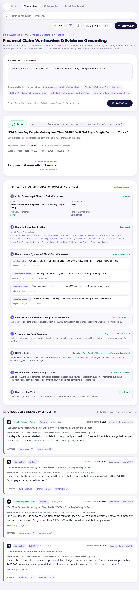

# FinGuard UI End-to-End Verification Audit

**Run date:** 2026-11-02  
**Scope:** Existing Next.js UI, `/api/verify` adapter, and Python Phase 2 API. No model or retrieval configuration was changed for this audit.

## Result

The browser-to-inference path was verified with a real claim. The browser submitted `POST /api/verify`; the Next.js route forwarded the claim to the current Python bridge at `POST /api/phase2/verify`; the backend returned a real BM25 + weighted RRF → cross-encoder → NLI result, which rendered with its retrieved evidence and provenance. The end-to-end browser case returned **TRUE**.

FALSE and NEI outcomes were also exercised through the live Next.js API route. These were HTTP/API tests, not separate browser-button interactions. They returned actual model verdicts without forcing or rewriting them.

## Architecture and execution evidence

```text
Browser: /verify
  -> POST /api/verify                    frontend/app/api/verify/route.ts
  -> POST /api/phase2/verify             src/api_bridge.py HTTP handler
  -> handle_verify(payload)
  -> FinGuardPipeline.run()              src/pipeline.py
       -> claim extraction and query construction
       -> BM25 per-query retrieval + configured Weighted RRF
       -> pretrained cross-encoder reranking
       -> pretrained NLI scoring and evidence aggregation
  <- actual verdict, scores, evidence and diagnostics
  <- UI renders result and evidence cards
```

The browser request was observed at `http://127.0.0.1:3000/api/verify` with HTTP 200. A successful response reported `retrieval_engine=bm25_weighted_rrf`, 15 retrieved candidates, 4 selected passages, `reranker_active=true`, and `Pretrained Cross-Encoder NLI (cross-encoder/nli-distilroberta-base)`. This confirms the API used the configured inference path, rather than a stored verdict fallback.

For the TRUE case, the response carried evidence `doc_id=5211` with retrieval and reranker scores, publisher/title metadata, and Snopes source URLs. The UI rendered the selected passages in reranked order, their retrieval/reranker and NLI scores, publisher labels, and clickable source links. The verdict banner and pipeline transparency section reflected backend response fields. The displayed model score is explicitly described as heuristic/uncalibrated, not a probability.

## Test outcomes

| Test | Method | Actual result |
|---|---|---|
| Homepage `/` | Browser and HTTP check | Loaded; HTTP 200. |
| Verification page `/verify` | Browser and HTTP check | Loaded; HTTP 200. |
| TRUE claim: “Did Biden Say People Making Less Than $400K ‘Will Not Pay a Single Penny in Taxes’?” | Entered and submitted in Chrome headless browser; observed `/api/verify` request/response | **TRUE**, HTTP 200; BM25 weighted RRF, 15 candidates, 4 selected, cross-encoder active, pretrained NLI active. Evidence and source metadata rendered. |
| FALSE claim: “Congress Removes Child Tax Credit, Mortgage Deduction, and EITC from Tax Code” | Live Next.js `/api/verify` request | **FALSE**; `bm25_weighted_rrf`, 15 retrieved, 4 selected, reranker active, pretrained NLI; 4 contradiction-classified passages. |
| NEI claim: “Is Biden Proposing a 3% Federal Property Tax?” | Live Next.js `/api/verify` request | **NEI**; `bm25_weighted_rrf`, 15 retrieved, 4 selected, reranker active, pretrained NLI; 4 neutral passages. |
| Empty/whitespace claim | Next.js API validation | HTTP 400 with `{"error":"Enter a non-empty financial claim."}`; no synthetic verdict returned. |
| Backend unavailable | Next.js API request with Python service stopped | HTTP 503 with service-unavailable error; no archived verdict fallback. |
| Repeated submissions | Repeated browser/API submissions | Repeated successful requests returned HTTP 200; page continued rendering results. |
| Source/evidence mapping | Browser output compared to actual API response | Passage text, IDs, publisher/title, source URLs, retrieval scores, reranker scores, and NLI scores came from response data. Source links matched response URLs. |

The NEI test returned four neutral NLI passages rather than an empty retrieval list. An actually empty evidence set was not produced in this run; the UI has a no-evidence state, but that exact backend condition remains unverified.

## Request/response example

Request body (no sensitive values):

```json
{
  "claim": "Did Biden Say People Making Less Than $400K 'Will Not Pay a Single Penny in Taxes'?"
}
```

Representative observed response fields:

```json
{
  "verdict": "true",
  "retrieval_engine": "bm25_weighted_rrf",
  "total_candidates_retrieved": 15,
  "reranker_active": true,
  "verifier_engine": "Pretrained Cross-Encoder NLI (cross-encoder/nli-distilroberta-base)",
  "selected_evidence_docs": [
    {
      "doc_id": 5211,
      "text": "Retrieved source passage returned by FinGuard",
      "publisher": "Snopes",
      "title": "Source title returned by FinGuard",
      "score": 0.0689,
      "rerank_score": 1.0,
      "source_urls": ["https://www.snopes.com/tag/joe-biden/"]
    }
  ]
}
```

Evidence text/title are abbreviated in this report; the UI displayed actual response content. NLI values are per-passage model outputs and are not calibrated confidence estimates.

## Commands and checks

| Command/check | Outcome |
|---|---|
| `python -m src.api_bridge serve --port 8000` | Started; current health endpoint returned HTTP 200. |
| `npm --prefix frontend run dev` | Started; current homepage and verification route returned HTTP 200. |
| Browser `/` and `/verify` | Both loaded in Chrome headless. |
| Browser DevTools observation of `POST /api/verify` | HTTP 200 for the TRUE case; actual response rendered. |
| `python -m unittest discover tests` | **119 passed** (previous full-suite run in this work session; the later-added `tests/test_api_integration.py` was not part of that run). |
| `Push-Location frontend; .\\node_modules\\.bin\\tsc.cmd --noEmit --pretty false` | Exit code 0 on the current frontend source. |
| `npm --prefix frontend run build` | Exit code 0 on the final recorded production build. Next reports that built-in type validation and linting are skipped; separate TypeScript check passed. |
| `python -m py_compile src\\api_bridge.py` | Passed. |

## Issues observed and resolution

1. **Stale Python API process:** The frontend route had been updated to call `/api/phase2/verify`, and the current `src/api_bridge.py` supports this path, but the already-running Python process predated that route alias. The first browser run returned HTTP 500 for later requests. Restarting the Python service from current source made `/api/phase2/verify` return valid JSON and the frontend proxy returned HTTP 200. No NLP code was changed to work around this.
2. **Mixed Next generated cache:** Switching between production builds and development had left inconsistent `.next` chunks. The first dev/browser pass logged missing chunks/static assets (404) and route failures (500). The old generated cache was preserved at `%TEMP%\\finguard-next-cache-before-audit`; the documented dev server then compiled a fresh cache, and the final pages and valid API requests returned HTTP 200. The old cache was not deleted.
3. **Empty input:** The Next route rejects blank claims with HTTP 400 rather than fabricating a NEI classification.

## Screenshot

Captured from the running browser after a real TRUE verification:



File: `outputs/finguard_phase2_running.png`

## Remaining limitations

- The FALSE and NEI outcomes were verified through the live Next API route, not independently clicked as distinct browser interactions. The complete browser-click path was observed for the TRUE case.
- A response with zero evidence passages was not obtained; the frontend’s empty-evidence presentation is therefore not verified against a real zero-evidence backend response.
- Browser console initially showed missing generated assets and failed requests during the stale-cache run. The final dev server compiled and served the tested routes successfully, but a separate retained clean-console export was not produced.
- `next build` skips its built-in type and lint checks; TypeScript was checked separately. ESLint remains unverified.
- Inference uses the archived FinFact corpus, not live web search. NLI/reranker scores and verdicts are research outputs, not calibrated financial advice.
- `tests/test_api_integration.py` exists in the current worktree but was not run as part of the recorded 119-test suite.

## Files and worktree notes

Created for this audit:

- `reports/UI_END_TO_END_VERIFICATION.md` — this report.

Screenshot artifact:

- `outputs/finguard_phase2_running.png` — browser capture of the live TRUE result.

Existing modified worktree files were preserved. No production model, dataset, thresholds, or historical experiment results were changed during this audit.
